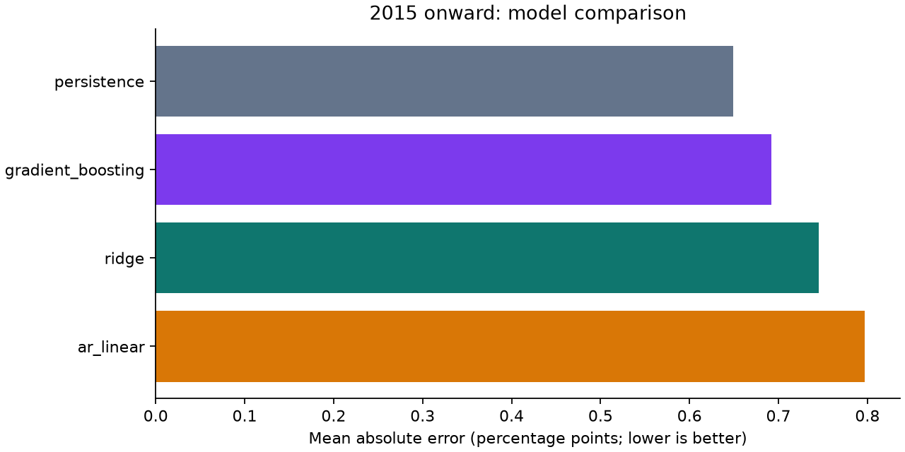

# Financial Data Science Lab

[](https://github.com/satmanpersonal/financial-data-science-lab/actions/workflows/ci.yml)

**Can a more complex model forecast unemployment better than simply predicting no change?**

A reproducible Python research project using the Philadelphia Fed's historical
unemployment snapshots. Each forecast uses the data vintage available at that
date, and each training label must already have been observable. Persistence,
an autoregressive linear benchmark, ridge regression, and gradient boosting
are evaluated on the same expanding-window forecast origins.

**Finding:** persistence has the lowest MAE across the full evaluation and the
2015 onward block. Added complexity does not reliably improve this benchmark.
The report preserves this result and shows sensitivity to the COVID shock.



## Results at a glance

Forecast horizon: three months after the latest **observation month** in a vintage.
Metrics are percentage points. Lower MAE and RMSE are better.

| Model | MAE, 2000 onward | MAE, 2015 onward | RMSE, 2015 onward |
| --- | ---: | ---: | ---: |
| Persistence | **0.435** | **0.649** | **1.916** |
| Autoregressive linear | 0.493 | 0.797 | 2.264 |
| Ridge | 0.463 | 0.745 | 2.019 |
| Gradient boosting | 0.448 | 0.692 | 1.932 |

There are 103 scored quarterly forecast origins from 2000 onward, including 43
from 2015 onward. The source workbook contains 244 vintages through August 2026;
three 2026 origins have incomplete feature histories and are explicitly excluded.
The October 2025 target is missing in the source and remains unscored. The latest
eligible forecast origin is November 2025. This is a historical research benchmark,
not a current forecast service.

Read the [full research report](reports/results.md) for all periods, bias,
shock sensitivity, and dependence-aware uncertainty in paired loss differences.
The sample ranking does not establish durable predictive superiority.

## What the project demonstrates

- **Data engineering:** validated XLSX ingestion, an immutable source snapshot,
  attribution, a download manifest, and checksum verification.
- **Temporal research design:** features built from each origin's own vintage;
  training gated by actual archived label availability; no random train/test split.
- **Model comparison:** simple baselines alongside regularized linear and nonlinear
  models, with preprocessing fitted only on available training observations.
- **Statistical judgment:** common evaluation samples, MAE/RMSE/bias, explicit shock
  sensitivity, and exploratory HAC intervals with their assumptions documented.
- **Engineering discipline:** packaged CLI, locked environment, regression tests,
  automated numerical reproduction, and GitHub Actions.

## Reproduce locally

Use Python **3.13** for the locked reference environment. No API key is needed.

```console
git clone https://github.com/satmanpersonal/financial-data-science-lab.git
cd financial-data-science-lab
python -m venv .venv
```

Activate the environment:

```powershell
# Windows PowerShell
.venv\Scripts\Activate.ps1
```

```bash
# macOS / Linux
source .venv/bin/activate
```

Install and run:

```console
python -m pip install -r requirements.lock
python -m pip install --no-deps -e .
python -m pip check
macrocast run
pytest -q
```

The evaluation uses the committed snapshot and makes no network requests.
Installation requires package downloads. For a new data snapshot, use
`macrocast fetch --refresh` and review the resulting changes.

To restrict the information set to older snapshots:

```console
macrocast run --as-of 2019-12-31 --output reports-2019
```

To verify numerical reproduction without replacing the committed report:

```console
macrocast run --output reproduced-reports
python scripts/check_reproduction.py reports reproduced-reports
ruff check .
ruff format --check .
```

CI performs the same checks on Linux. Numeric results are compared with
`rtol=1e-7, atol=1e-8`; rendered PNG bytes are not compared across platforms.

## Navigate the repository

| Path | Contents |
| --- | --- |
| [`src/macrocast/data.py`](src/macrocast/data.py) | Source retrieval, validation, provenance |
| [`src/macrocast/dataset.py`](src/macrocast/dataset.py) | Vintage features and label-availability clock |
| [`src/macrocast/evaluate.py`](src/macrocast/evaluate.py) | Models, expanding windows, metrics, HAC comparisons |
| [`reports/results.md`](reports/results.md) | Generated research note and figures |
| [`reports/predictions.csv`](reports/predictions.csv) | Forecast-level results and training audit fields |
| [`reports/excluded_origins.csv`](reports/excluded_origins.csv) | Missing-feature exclusions |
| [`reports/run.json`](reports/run.json) | Environment, snapshot hash, configuration |
| [`docs/methodology.md`](docs/methodology.md) | Research design and limitations |
| [`docs/data.md`](docs/data.md) | Source documentation and update policy |
| [`tests/`](tests) | Leakage, availability, parser, metrics, and report checks |

## Limits and next experiments

The information set contains only lagged unemployment. The label is the first
archived quarterly snapshot containing the target, **not necessarily the original
BLS release**. Source snapshot dates approximate information availability without
intraday publication latency. The small quarterly sample and structural breaks
limit statistical inference. The 2015 onward block is retrospective, not a
prospectively sealed holdout.

Useful next experiments are adding release-timed employment and yield-curve
vintages, comparing rolling and expanding estimation, and preregistering a
hyperparameter-selection protocol. Any extension should preserve the information
clock and keep the simple baseline visible.

This is independent educational research with no BlackRock or Federal Reserve
affiliation. It models an economic indicator and makes no investment-return claims.
Original code is MIT licensed; source data is separately attributed in
[data provenance](docs/data.md).
