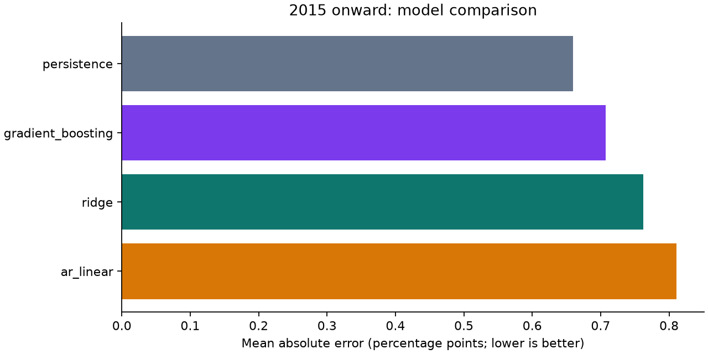
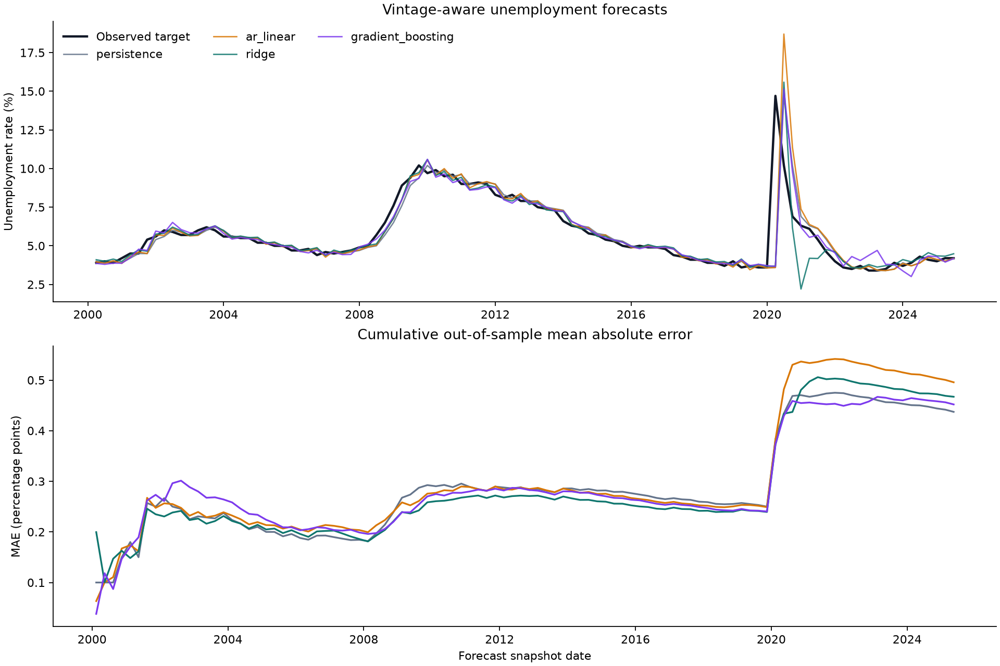

# Research results

Generated from the committed snapshot. Data SHA-256: `d971e59d3ed5f1322a46631743508fb1ad5eee39bfbe12425a641a277fdd9b9a`.

## Question and design

Can lagged unemployment dynamics improve on a no-change forecast of the unemployment
rate three observation months ahead? One sample is a quarterly historical snapshot.
All models use identical forecast origins and targets. Feature values come exclusively
from the origin's archived vintage, with no historical backfilling from later snapshots.
Training labels must be observable by the forecast origin.

Origins span 1965-11-15 to 2025-08-15.
Evaluation starts in 2000 after at least 80 labeled training origins. The 2015 onward
block is reported separately, with fixed hyperparameters and expanding refits.
This is a retrospective research demonstration, not a prospectively sealed holdout.

## Main comparison: 2015 onward

| model | n | mae | rmse | bias | mae_skill_vs_persistence |
| --- | --- | --- | --- | --- | --- |
| persistence | 42 | 0.660 | 1.939 | 0.036 | 0.000 |
| gradient_boosting | 42 | 0.707 | 1.955 | 0.041 | -0.072 |
| ridge | 42 | 0.762 | 2.043 | -0.179 | -0.156 |
| ar_linear | 42 | 0.811 | 2.291 | 0.159 | -0.230 |

Lowest observed MAE: **persistence**, **0.660 percentage points**.
This sample ranking is not evidence of durable superiority or investment profitability.

## All reported periods and shock sensitivity

| period | model | n | mae | rmse | bias | mae_skill_vs_persistence |
| --- | --- | --- | --- | --- | --- | --- |
| all | ar_linear | 102 | 0.496 | 1.497 | 0.059 | -0.134 |
| all | gradient_boosting | 102 | 0.452 | 1.283 | -0.007 | -0.034 |
| all | persistence | 102 | 0.437 | 1.281 | -0.002 | 0.000 |
| all | ridge | 102 | 0.467 | 1.337 | -0.075 | -0.068 |
| development_2000_2014 | ar_linear | 60 | 0.275 | 0.366 | -0.011 | 0.024 |
| development_2000_2014 | gradient_boosting | 60 | 0.273 | 0.352 | -0.041 | 0.030 |
| development_2000_2014 | persistence | 60 | 0.282 | 0.399 | -0.028 | 0.000 |
| development_2000_2014 | ridge | 60 | 0.260 | 0.343 | -0.003 | 0.075 |
| evaluation_2015_onward | ar_linear | 42 | 0.811 | 2.291 | 0.159 | -0.230 |
| evaluation_2015_onward | gradient_boosting | 42 | 0.707 | 1.955 | 0.041 | -0.072 |
| evaluation_2015_onward | persistence | 42 | 0.660 | 1.939 | 0.036 | 0.000 |
| evaluation_2015_onward | ridge | 42 | 0.762 | 2.043 | -0.179 | -0.156 |
| excluding_2020_2021 | ar_linear | 94 | 0.243 | 0.323 | 0.005 | -0.000 |
| excluding_2020_2021 | gradient_boosting | 94 | 0.271 | 0.370 | 0.021 | -0.116 |
| excluding_2020_2021 | persistence | 94 | 0.243 | 0.344 | 0.002 | 0.000 |
| excluding_2020_2021 | ridge | 94 | 0.240 | 0.312 | 0.055 | 0.012 |

The 2020–2021 exclusion is a prespecified sensitivity view. The headline comparison
includes these shocks. Positive bias means overprediction. MAE, RMSE, and bias are
all in percentage points; the sample count is the number of quarterly forecast origins.
MAE skill is dimensionless: `1 - model MAE / persistence MAE`; positive values
favor the alternative and negative values indicate a worse forecast.

## Uncertainty in differences from persistence

| period | model | n | mae_difference_vs_persistence | ci95_low | ci95_high |
| --- | --- | --- | --- | --- | --- |
| all | ar_linear | 102 | 0.058 | -0.049 | 0.166 |
| all | ridge | 102 | 0.030 | -0.050 | 0.109 |
| all | gradient_boosting | 102 | 0.015 | -0.049 | 0.078 |
| evaluation_2015_onward | ar_linear | 42 | 0.151 | -0.091 | 0.394 |
| evaluation_2015_onward | ridge | 42 | 0.103 | -0.067 | 0.273 |
| evaluation_2015_onward | gradient_boosting | 42 | 0.048 | -0.081 | 0.176 |

Negative differences favor the alternative. These are pointwise 95% intervals for
mean paired absolute-loss differences, estimated with an intercept-only OLS and
HAC covariance (four ordered forecast-origin lags, finite-sample correction, t reference).
They allow local serial correlation and heteroskedasticity under asymptotic conditions;
they do not establish stationarity or robustness to structural breaks. Small samples,
COVID outliers, and multiple comparisons limit inference. These are exploratory,
unadjusted intervals, not simultaneous intervals or model-selection guarantees.

## Latest archived-origin predictions

| origin | target_month | model | prediction | n_train |
| --- | --- | --- | --- | --- |
| 2025-08-15 00:00:00 | 2025-10-01 00:00:00 | persistence | 4.200 | 239 |
| 2025-08-15 00:00:00 | 2025-10-01 00:00:00 | ar_linear | 4.200 | 239 |
| 2025-08-15 00:00:00 | 2025-10-01 00:00:00 | ridge | 4.406 | 239 |
| 2025-08-15 00:00:00 | 2025-10-01 00:00:00 | gradient_boosting | 4.433 | 239 |

These are forecasts at the last included historical snapshot, not necessarily at the
present date. Unknown outcomes remain missing and are excluded from scoring.

## Missing-data audit

Latest source vintage: **2026-08-15**.
Excluded feature origins: **4**. Unobserved targets across all eligible
origins: **1**. All models share the same exclusions.

| origin | reason |
| --- | --- |
| 2025-11-15 | Target month already started; latest observation: 2025-08 |
| 2026-02-15 | Need 13 consecutive observed months; missing: 2025-10 |
| 2026-05-15 | Need 13 consecutive observed months; missing: 2025-10 |
| 2026-08-15 | Need 13 consecutive observed months; missing: 2025-10 |

Origins with gaps in the required 13-month feature window are excluded and the
missing months appear in the audit. Missing targets remain unknown. Consequently,
the latest eligible forecast can precede the latest source vintage. Missing values
are never imputed or replaced by revised future data. The dataset also exposes the
age of the latest observed month; histories so stale that the target month has
already begun at the forecast origin are excluded.

## Interpretation and limits

- Only unemployment history is used. This is an interpretable univariate benchmark,
  not a complete macroeconomic information set or a trading strategy.
- The target uses the first archived quarterly snapshot containing that target month.
  This is **not guaranteed to be the BLS initial-release value**.
- Snapshot dates are Feb/May/Aug/Nov 15, as documented by the publisher. This assumes
  the snapshot is available on that date; publication-time and latency simulation is
  outside scope. The horizon is three months from the last observation month, roughly
  2.5 months from the usual snapshot date to the target's release.
- About 60 years of quarterly snapshots provide few independent observations for ML.
  Nonlinearity may add variance; fitting a model successfully does not validate it.
- Historical data collection and seasonal-adjustment revisions may contain errors.
  This snapshot is reproducible; refreshing the upstream workbook can change results.
- No causal claims, calibrated prediction intervals, or investment returns are implied.

See [methodology](../docs/methodology.md), [data provenance](../docs/data.md),
and the exact [run metadata](run.json). Forecast rows include training counts and
the latest training-label date for independent leakage audits.
