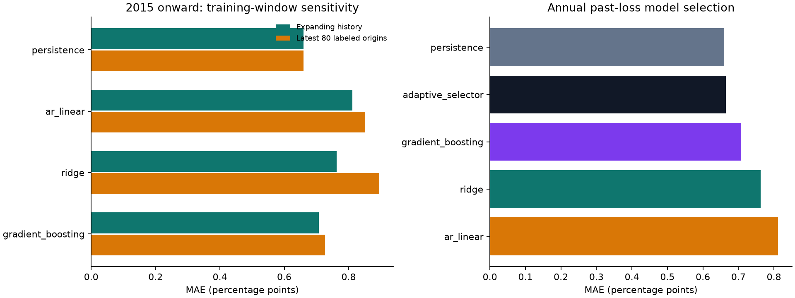

# Robustness and model-selection experiments

These analyses were added **after** the initial fixed-model results were observed.
They are exploratory. Their historical outcomes cannot become a new untouched holdout.
The fixed-model comparison remains the primary benchmark. Its eligibility policy
now excludes origins with an already-started target month, keeping future-month
forecasts separate from nowcasts. The original version is preserved in Git history.

## Training-window sensitivity

Compare expanding history with the latest 80 labeled origins (about 20 years).
Both use identical feature definitions, label-availability constraints, fixed model
settings, forecast origins and targets. A shorter history may adapt faster but has
higher estimation variance. No window length was chosen by maximizing evaluation performance.

| model | n | mae | rmse | mae_skill_vs_persistence |
| --- | --- | --- | --- | --- |
| ar_linear | 42 | 0.851 | 2.372 | -0.290 |
| gradient_boosting | 42 | 0.727 | 1.995 | -0.102 |
| persistence | 42 | 0.660 | 1.939 | 0.000 |
| ridge | 42 | 0.895 | 2.505 | -0.357 |

## Annual model selection using only matured past forecasts

At the first eligible forecast origin of each calendar year from 2015 onward,
choose among the four fixed candidates by MAE on the latest 20 **prior** forecast
origins whose targets have become observable. Require 12 validation origins or
fall back to persistence; break exact ties in the declared model order, persistence
first. Freeze that choice for the year while the underlying candidates continue
their ordinary expanding-window refits. This reuses authentic historical
out-of-sample forecasts. It does not select hyperparameters or use random folds.

| model | n | mae | rmse | mae_skill_vs_persistence |
| --- | --- | --- | --- | --- |
| persistence | 42 | 0.660 | 1.939 | 0.000 |
| adaptive_selector | 42 | 0.664 | 1.941 | -0.007 |
| gradient_boosting | 42 | 0.707 | 1.955 | -0.072 |
| ridge | 42 | 0.762 | 2.043 | -0.156 |
| ar_linear | 42 | 0.811 | 2.291 | -0.230 |

Positive MAE skill means improvement over persistence on the same origins.
Selection years per candidate: `{'ar_linear': 1, 'gradient_boosting': 6, 'persistence': 4}`. The audit records each candidate's validation
MAE, validation count, latest validation origin, and latest available label date.
Selection is past-only, but choosing this research question after viewing the
baseline results remains a researcher-level source of adaptation. No confirmatory
significance claim is attached to this additional comparison.

## Contiguous calendar blocks

| model | n | mae | rmse | bias | mae_skill_vs_persistence | regime |
| --- | --- | --- | --- | --- | --- | --- |
| ar_linear | 60 | 0.275 | 0.366 | -0.011 | 0.024 | 2000_2014 |
| gradient_boosting | 60 | 0.273 | 0.352 | -0.041 | 0.030 | 2000_2014 |
| persistence | 60 | 0.282 | 0.399 | -0.028 | 0.000 | 2000_2014 |
| ridge | 60 | 0.260 | 0.343 | -0.003 | 0.075 | 2000_2014 |
| ar_linear | 20 | 0.171 | 0.216 | 0.066 | -0.104 | 2015_2019 |
| gradient_boosting | 20 | 0.142 | 0.184 | 0.095 | 0.085 | 2015_2019 |
| persistence | 20 | 0.155 | 0.199 | 0.105 | 0.000 | 2015_2019 |
| ridge | 20 | 0.176 | 0.225 | 0.133 | -0.137 | 2015_2019 |
| ar_linear | 8 | 3.470 | 5.228 | 0.694 | -0.273 | 2020_2021 |
| gradient_boosting | 8 | 2.582 | 4.404 | -0.339 | 0.052 | 2020_2021 |
| persistence | 8 | 2.725 | 4.419 | -0.050 | 0.000 | 2020_2021 |
| ridge | 8 | 3.139 | 4.652 | -1.600 | -0.152 | 2020_2021 |
| ar_linear | 14 | 0.206 | 0.246 | -0.014 | -0.029 | 2022_onward |
| gradient_boosting | 14 | 0.444 | 0.580 | 0.181 | -1.218 | 2022_onward |
| persistence | 14 | 0.200 | 0.239 | -0.014 | 0.000 | 2022_onward |
| ridge | 14 | 0.241 | 0.274 | 0.188 | -0.207 | 2022_onward |

These are descriptive calendar blocks, not inferred economic regimes or a live
regime detector. Small denominators make rankings unstable. No hindsight-based
regime switches are used in the forecasts.

## What drives aggregate error?

Shares of each model's total absolute and squared forecast errors arising at
2020–2021 origins:

| model | absolute_error_share | squared_error_share |
| --- | --- | --- |
| ar_linear | 0.549 | 0.957 |
| gradient_boosting | 0.448 | 0.924 |
| persistence | 0.489 | 0.933 |
| ridge | 0.527 | 0.950 |

Largest three absolute-error origins per model:

| model | origin | absolute_error | squared_error_share |
| --- | --- | --- | --- |
| ar_linear | 2020-02-15 00:00:00 | 11.103 | 0.540 |
| ar_linear | 2020-05-15 00:00:00 | 8.498 | 0.316 |
| ar_linear | 2020-08-15 00:00:00 | 4.488 | 0.088 |
| gradient_boosting | 2020-02-15 00:00:00 | 11.031 | 0.724 |
| gradient_boosting | 2020-05-15 00:00:00 | 4.936 | 0.145 |
| gradient_boosting | 2020-08-15 00:00:00 | 2.887 | 0.050 |
| persistence | 2020-02-15 00:00:00 | 11.100 | 0.736 |
| persistence | 2020-05-15 00:00:00 | 4.500 | 0.121 |
| persistence | 2020-08-15 00:00:00 | 3.300 | 0.065 |
| ridge | 2020-02-15 00:00:00 | 11.014 | 0.665 |
| ridge | 2020-05-15 00:00:00 | 5.388 | 0.159 |
| ridge | 2020-11-15 00:00:00 | 4.094 | 0.092 |

Concentration in a few shock origins limits how much can be learned from average
scores alone. Forecast-origin dates differ from target-month dates. Error shares
are descriptive contributions, not causal investment attribution.

## Practical interpretation

This benchmark can inform how to validate a macroeconomic input to scenario
analysis. It does not map unemployment forecasts into asset returns or portfolio
weights. Before using such an input in investment research, specify the decision,
release-time availability, downstream exposure, forecast uncertainty, transaction
costs where relevant, and a separate prospective evaluation.
